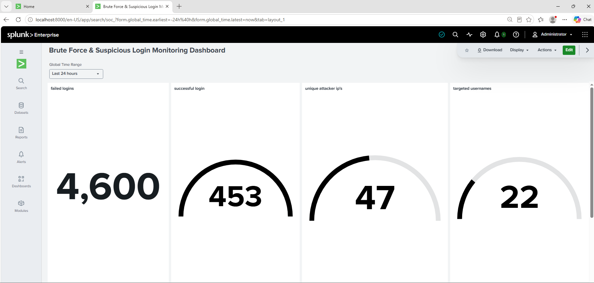
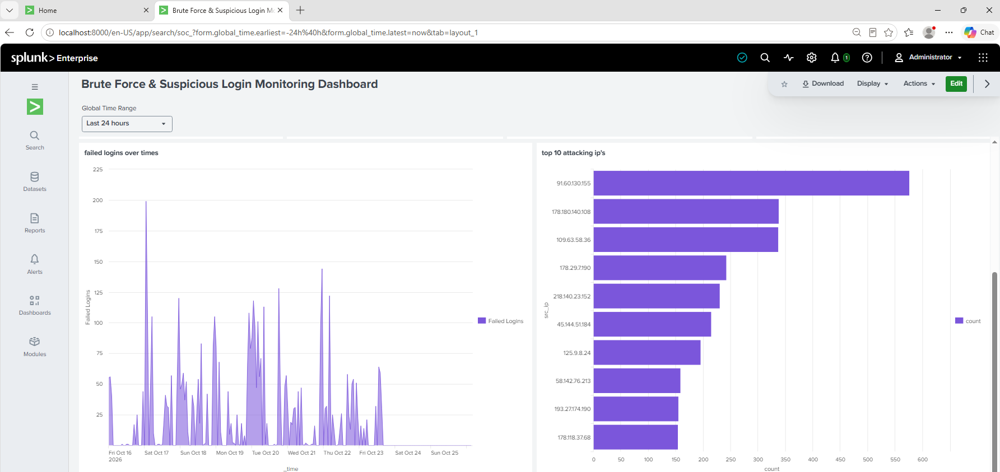
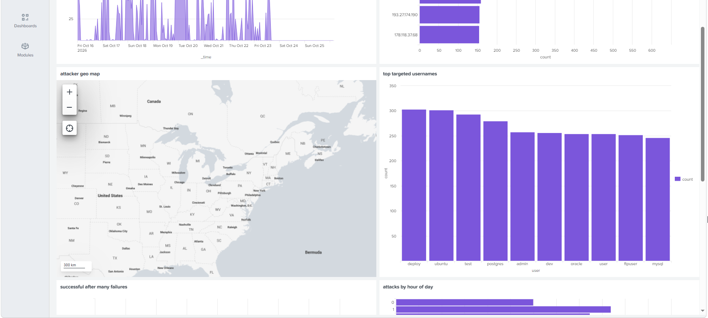
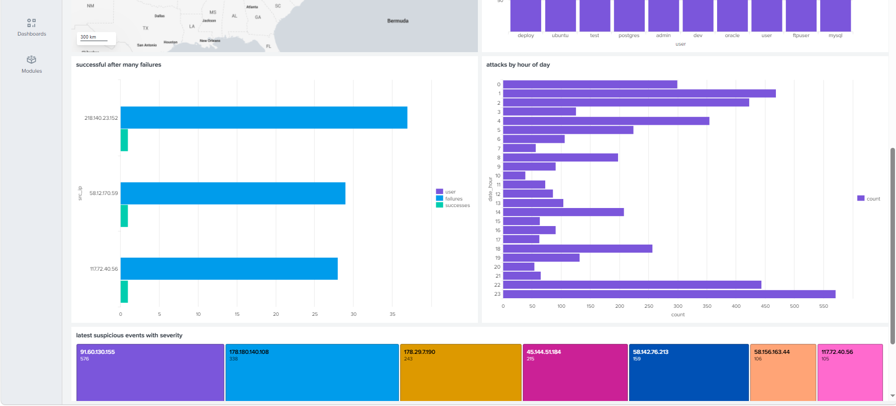

# SOC Threat Monitor: SSH Brute Force & Suspicious Login Detection (Splunk)

A Splunk dashboard that turns raw Linux `auth.log` data into a SOC-style view of SSH brute-force attacks, targeted accounts, attacker locations and possible account compromise.

> **Note:** All data in this repo is **simulated** for learning and portfolio purposes. No real systems, users or IP activity are involved.

**MITRE ATT&CK:** [T1110 – Brute Force](https://attack.mitre.org/techniques/T1110/)

## Dashboard preview

| | |
|---|---|
|  |  |
|  |  |

## What the dashboard shows

| # | Panel | Purpose |
|---|---|---|
| 1 | KPI tiles | Failed logins, successful logins, unique attacker IPs, usernames targeted |
| 2 | Failed logins over time | Spot attack spikes |
| 3 | Top 10 attacking IPs | Find the noisiest sources |
| 4 | Attacker geo map | See where attacks come from |
| 5 | Top targeted usernames | Reveal common guessed accounts (root, admin, ubuntu, test...) |
| 6 | Success after many failures | **Possible compromised accounts**, the key detection |
| 7 | Attacks by hour of day | Detect off-hours attack patterns |
| 8 | Attacker severity ranking | Prioritise by attempt count (Critical / High / Medium / Low) |

## Key detection logic

A failed login is noise. A **successful login from an IP that previously failed 10+ times** is an investigation trigger:

```spl
index=soc_lab sourcetype=linux_secure ("Failed password" OR "Accepted password")
| rex "(?<outcome>Failed|Accepted) password for (?:invalid user )?(?<user>\S+) from (?<src_ip>\d+\.\d+\.\d+\.\d+)"
| stats count(eval(outcome="Failed")) AS failures count(eval(outcome="Accepted")) AS successes by src_ip user
| where failures>=10 AND successes>=1
| sort - failures
```

All 8 panel queries are in [`queries/splunk_queries.md`](queries/splunk_queries.md).

## Setup

1. Install Splunk Enterprise (free trial works).
2. Go to **Settings → Add Data → Upload** and select `data/auth.log`.
3. Set the sourcetype to `linux_secure` and create a new index named `soc_lab`.
4. Confirm the data: search `index=soc_lab` with the time range set to **All time** (about 9,300 events).
5. Create a new dashboard and add one panel per query from `queries/splunk_queries.md`.
6. Choose the dark theme for best readability.

## Repository structure

```
.
├── data/
│   ├── auth.log                  # simulated SSH auth log (7 days)
│   └── generate_auth_log.py      # script used to generate it
├── queries/
│   └── splunk_queries.md         # SPL for every panel
├── screenshots/                  # dashboard images
├── dashboard/                    # exported dashboard source (JSON)
└── README.md
```

## About the simulated data

`data/generate_auth_log.py` generates about 9,300 log lines covering 7 days:

- Around 4,600 failed password attempts from 60 fake attacker IPs, with a few IPs responsible for most attacks
- Attack activity weighted toward night hours
- 3 simulated compromises (successful login after 25 failed attempts)
- Normal working-hours logins from internal IPs and routine `sudo` activity

## Tech stack

Splunk Enterprise · SPL (`rex`, `stats`, `timechart`, `iplocation`, `geostats`) · Linux auth.log · Python (data generation) · VMware Workstation lab

## What I learned

- Writing field extractions with `rex` on unstructured logs
- Designing dashboards around analyst questions rather than just charts
- Turning a raw event (failed login) into a detection (success after repeated failures)
- Mapping detections to MITRE ATT&CK

## Roadmap

- [ ] Web attack dashboard (SQLi, XSS, scanners) from Apache/Nginx logs
- [ ] Windows event monitoring (4624 / 4625) with Sysmon
- [ ] Alerts for the compromise detection
- [ ] MITRE ATT&CK coverage view

## Author

**Your Name** · [LinkedIn](https://www.linkedin.com/in/aditya-udugade-28147b345/) · [GitHub](https://github.com/adiiitya01)
